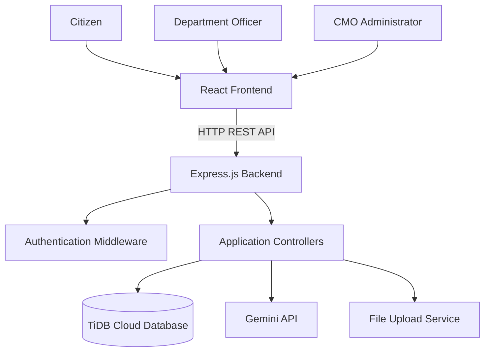

# System Architecture

## 1. Introduction

The CM Kerala Grievance Portal follows a client-server architecture. It separates the user interface, backend business logic, database operations and external service integrations.

The application provides three primary user roles:

- Citizen
- Department Officer
- Chief Minister's Office (CMO)

## 2. High-Level Architecture

## 3. Frontend Architecture

The frontend is developed using React and provides separate interfaces for citizens, department officers and CMO administrators.

### Main frontend modules

| Module | Responsibility |
|---|---|
| Components | Reusable interface elements |
| Context | Authentication and shared application state |
| Pages | Role-specific application screens |
| Services | Backend API communication |
| App.jsx | Application routing and page structure |

### Frontend technologies

- React
- JavaScript
- Tailwind CSS
- React Router
- Axios
- Lucide React

## 4. Backend Architecture

The backend uses Node.js and Express.js to handle API requests, authentication, business logic and database operations.

### Backend modules

| Module | Responsibility |
|---|---|
| config | Database configuration and connection |
| controllers | Application business logic |
| middleware | Authentication, authorization and file upload handling |
| routes | API endpoint definitions |
| services | Supporting integrations and AI functionality |
| server.js | Express application configuration and startup |

### Request processing flow

1. A user performs an action in the frontend.
2. Axios sends an HTTP request to the backend.
3. Express receives the request through the appropriate route.
4. Middleware validates authentication and permissions where required.
5. The corresponding controller processes the request.
6. The controller interacts with the database or an external service.
7. The backend returns a JSON response.
8. The frontend updates the interface based on the response.

## 5. Authentication and Authorization

The application uses JSON Web Tokens (JWT) for authentication.

The authentication process includes:

1. Users submit their login credentials.
2. The backend verifies the credentials.
3. Passwords are checked using bcryptjs.
4. A JWT is generated for authenticated users.
5. The frontend uses the token when communicating with protected API endpoints.
6. Backend middleware validates the token and checks the user's role before allowing restricted operations.

## 6. Role-Based Application Workflow

### Citizen workflow

1. Register and log in.
2. Submit a grievance.
3. Receive a grievance reference number.
4. Track the grievance.
5. View grievance updates and history.
6. Submit feedback.

### Department Officer workflow

1. Log in through the officer portal.
2. Access assigned grievances.
3. Review grievance information.
4. Process grievances and update their status.
5. Record relevant processing information.

### CMO workflow

1. Log in through the CMO portal.
2. Access the centralized dashboard.
3. Monitor grievance statistics.
4. Review grievance progress.
5. Oversee grievance processing.

## 7. Database Architecture

The application uses TiDB Cloud, which is compatible with MySQL.

The database stores:

- User accounts and roles
- Department information
- Grievance records
- Department assignments
- Uploaded attachment metadata
- Grievance history
- Citizen feedback
- Contact enquiries

The backend communicates with the database using the mysql2 Node.js driver.

## 8. External Integrations

### Google Gemini API

The backend integrates with Google's Gemini API for AI-assisted grievance analysis.

### TiDB Cloud

Provides the hosted relational database used by the application.

### File Upload Handling

Multer handles incoming file uploads. The current implementation uses backend local storage. Persistent external storage is a planned deployment improvement.

## 9. Deployment Architecture

| Component | Hosting Platform |
|---|---|
| React frontend | Vercel |
| Express backend | Render |
| Relational database | TiDB Cloud |
| Source code | GitHub |

The frontend communicates with the deployed backend through HTTPS REST API requests.

## 10. Security Considerations

The architecture incorporates:

- JWT authentication
- Password hashing
- Role-based authorization
- Helmet security headers
- CORS configuration
- Environment-based configuration
- SSL database connectivity

Additional production hardening includes persistent attachment storage, backup recovery procedures and ongoing security reviews.

## 11. Conclusion

The architecture separates frontend presentation, backend processing, database management and external integrations. This structure supports maintainability and allows individual application components to be improved independently.
